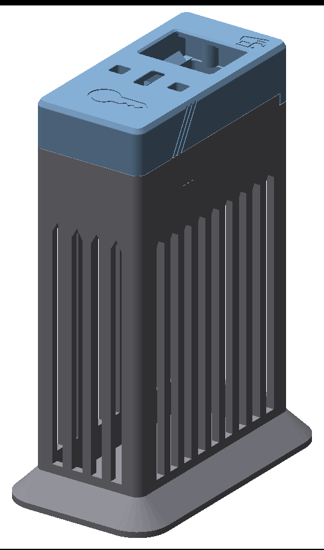

# Phone Vault

A replacement bottom housing for the Lockbox. It locks away a phone or a pack of cigarettes, and vertical bars keep the item in view. The stock top housing slides on and latches as usual.

[Print (STL)](print/phone-vault.stl) · [Edit (FreeCAD)](cad/phone-vault.FCStd) · [STEP](cad/phone-vault.step) · [Sections](img/phone-vault-sections.png)

- Holds a phone up to about 165 × 78 × 9 mm in a case, or a king-size pack, standing on end.
- Print upright on the base, opening up. The bars and foot need no supports. The part is 178.5 mm tall and fits an A1 mini.
- Press the back magnet into the new top pocket, south side up. Then glue the four rubber feet to the base.
- The Lockbox stand does not fit this part.

Design by Research and Desire, based on the Lockbox bottom housing. Licensed under CERN-OHL-S v2 (see [LICENSE](LICENSE)). The FreeCAD `Params` sheet sets the depth, wall and bar sizes.
