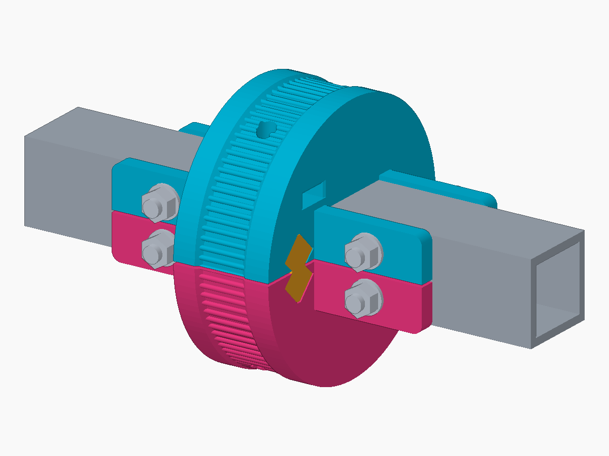

# Bedframe PitClamp Adapter

A parametric bedframe mount based on **Yous34’s original two-piece mounting-ring
concept** from KinkyMakers. Two identical main halves and two identical removable
keys fit around nominal 1-inch (25.4 mm) square metal tube. Place the halves around
the rail, insert the keys, then fit the M5 hardware; no lengthwise half sliding is
needed. This ABS prototype is unprinted, with no tested physical compatibility or
load rating.

[3MF](https://media.githubusercontent.com/media/researchanddesire/community-mods/a68df11c81e2c56ac8c6a5e038778056bd36ed68/mods/ossm/bedframe-pitclamp-adapter/print/full-print-set.3mf) · [FreeCAD](https://media.githubusercontent.com/media/researchanddesire/community-mods/a68df11c81e2c56ac8c6a5e038778056bd36ed68/mods/ossm/bedframe-pitclamp-adapter/cad/Bedframe-Adapter-Keystones.FCStd) · [Editable source](https://media.githubusercontent.com/media/researchanddesire/community-mods/a68df11c81e2c56ac8c6a5e038778056bd36ed68/mods/ossm/bedframe-pitclamp-adapter/cad/bedframe-adapter-source.zip) · [STEP assembly](https://media.githubusercontent.com/media/researchanddesire/community-mods/a68df11c81e2c56ac8c6a5e038778056bd36ed68/mods/ossm/bedframe-pitclamp-adapter/cad/Bedframe-Adapter-Reference-Assembly.step)

- Print main halves flat, curve up; print keys with their +X ends down.
- Use ABS, supports and 4 mm-high DIN 934 M5 nuts. Fit keys before hardware; remove locator hardware and primary shafts before extracting keys.
- Through-drilled rail holes and custom metal compression sleeves are required; see the [BOM and assembly notes](https://github.com/researchanddesire/community-mods/blob/a68df11c81e2c56ac8c6a5e038778056bd36ed68/mods/ossm/bedframe-pitclamp-adapter/docs/assembly.md).

Adapter design by **Lucy Chapar**. PitClamp Mini by **armpit / KinkyMakers**,
[source commit b7f01bf6](https://github.com/KinkyMakers/OSSM-hardware/commit/b7f01bf6df1be6f3ebf17dc0e31ed64ddf4c15b7).
[CERN-OHL-S-2.0](../../../LICENSES/CERN-OHL-S-2.0.txt).
