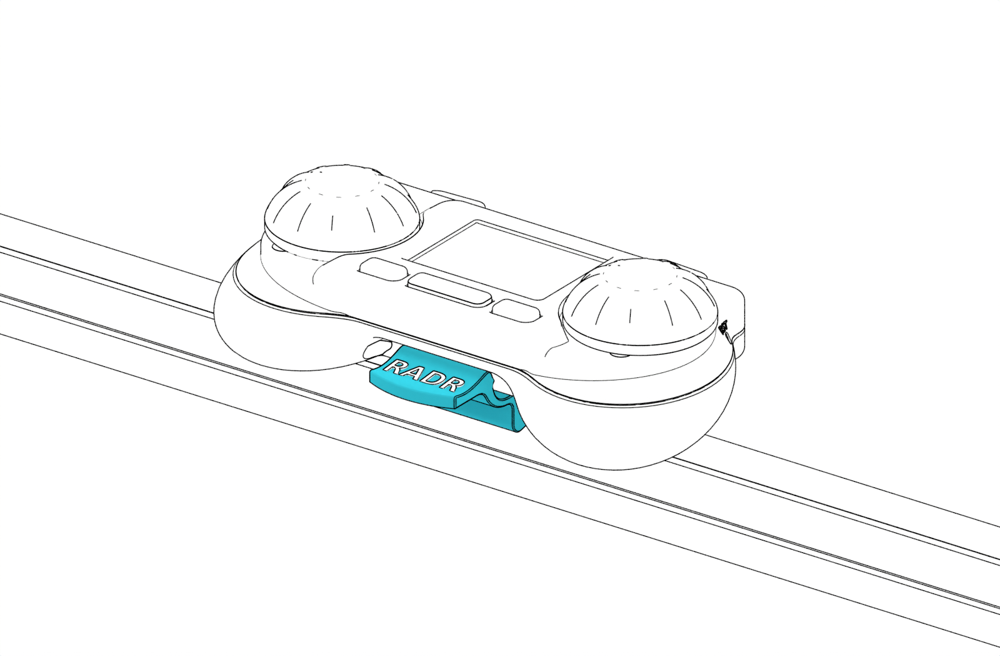

# OSSM Remote Clip

A printable mount that keeps the RADR wireless remote on an OSSM extrusion frame. The bottom-release tab lets you remove the remote for handheld use.

[Print (STL)](print/ossm-remote-clip.stl) · [Edit (STEP)](cad/ossm-remote-clip.step) · [Mounting close-up](img/remote-clip-linework-detail.png)

- Print with **six walls** for repeated attachment and removal.
- Mount the clip with an **M6 × 12 mm bolt** and an M6 t-nut.
- Check that the remote latches securely and releases freely before use.

Design by [Research and Desire](https://github.com/researchanddesire/radr-wireless-remote), from the RADR wireless remote project. Licensed under CERN-OHL-S v2 through the repository license.
