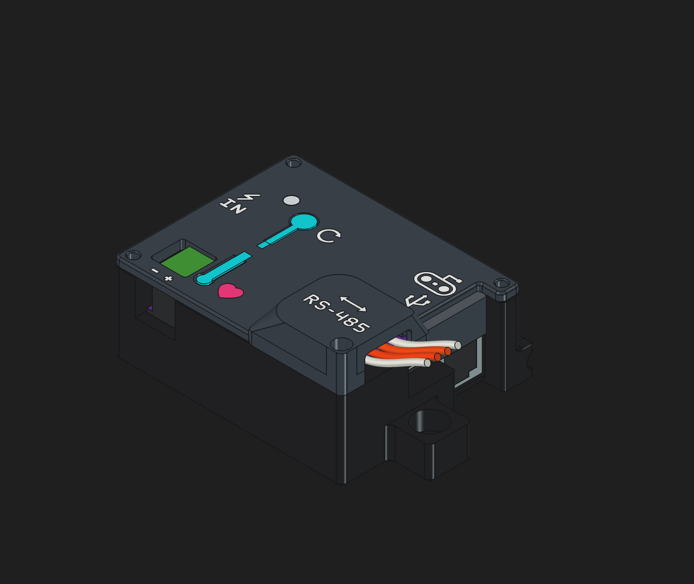
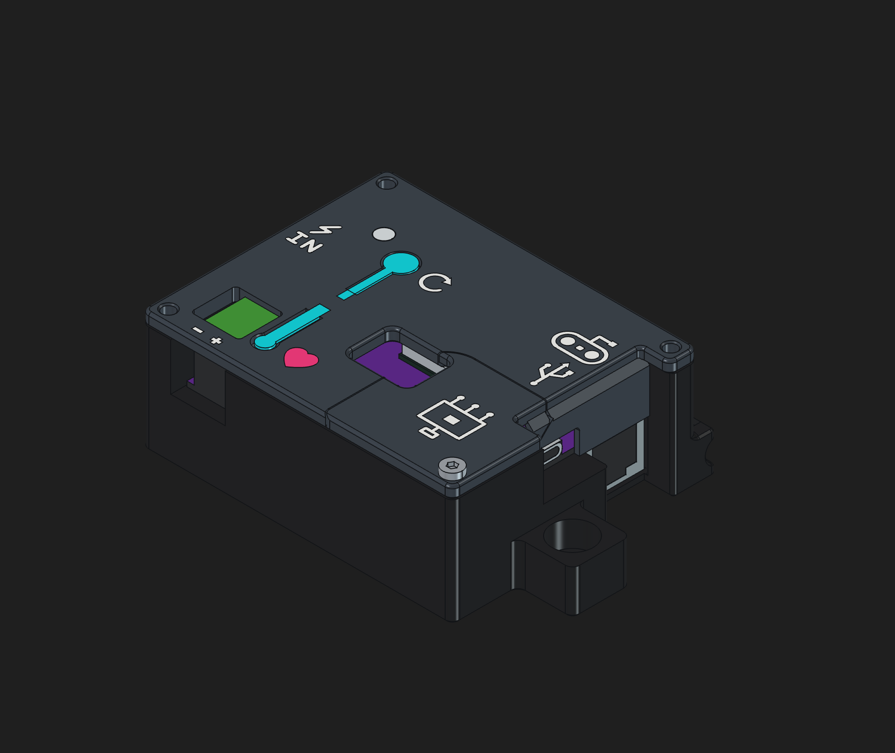
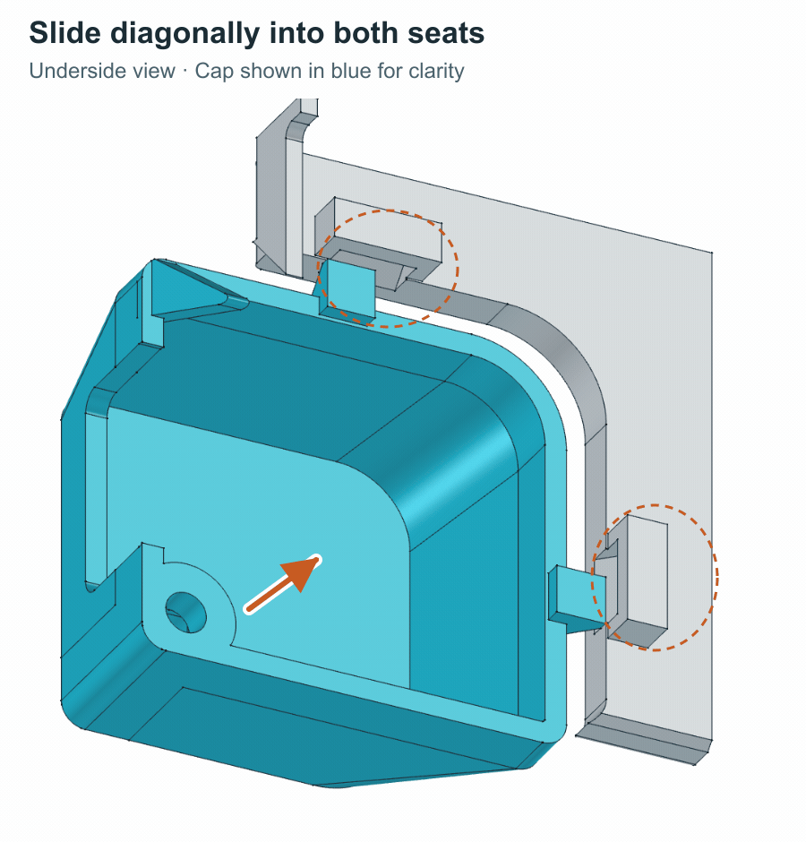

# OSSM RS-485 PCB Cover

Choose a raised RS-485 cap or a flat accessories panel with a stepper cable opening and breakout icon. Underside skirts hide the board while keeping the ports accessible.

| Version | Print | Edit | Export |
| --- | --- | --- | --- |
| RS-485 cap | [3MF](https://media.githubusercontent.com/media/researchanddesire/community-mods/94b432b71fa9aa48064964e3fc7779f117eebf24/mods/ossm/ossm-rs485-pcb-cover/print/OSSM-RS485-Complete.3mf) | [FreeCAD](https://media.githubusercontent.com/media/researchanddesire/community-mods/94b432b71fa9aa48064964e3fc7779f117eebf24/mods/ossm/ossm-rs485-pcb-cover/cad/OSSM-Cover-RS485.FCStd) | [STEP](https://media.githubusercontent.com/media/researchanddesire/community-mods/94b432b71fa9aa48064964e3fc7779f117eebf24/mods/ossm/ossm-rs485-pcb-cover/cad/OSSM-Cover-RS485.step) |
| Flat accessories panel | [3MF](https://media.githubusercontent.com/media/researchanddesire/community-mods/94b432b71fa9aa48064964e3fc7779f117eebf24/mods/ossm/ossm-rs485-pcb-cover/print/OSSM-Accessories-Complete.3mf) | [FreeCAD](https://media.githubusercontent.com/media/researchanddesire/community-mods/94b432b71fa9aa48064964e3fc7779f117eebf24/mods/ossm/ossm-rs485-pcb-cover/cad/OSSM-Cover-Accessories.FCStd) | [STEP](https://media.githubusercontent.com/media/researchanddesire/community-mods/94b432b71fa9aa48064964e3fc7779f117eebf24/mods/ossm/ossm-rs485-pcb-cover/cad/OSSM-Cover-Accessories.step) |

Colors occupy only the first 0.6 mm; the remaining cover structure is black. The separate light-pipe insert stays clear.

- Each 3MF contains three plates: main cover, matching corner piece and clear insert, with colors assigned.
- Print the main cover and flat panel front-down, or the raised cap roof-down, with supports off.
- Slide both tabs diagonally into their seats, then fasten the corner screw. [Tab-seat cutaway](img/inward-stop-section.png).

By [Lucy Chapar](https://github.com/lucy-chapar), based on the [OSSM PCB enclosure](https://github.com/researchanddesire/OSSM/tree/main/hardware/cad/stand). [CERN-OHL-S-2.0](../../../LICENSES/CERN-OHL-S-2.0.txt).
