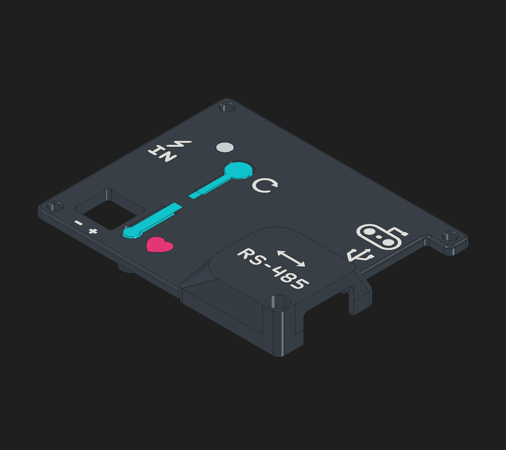

# OSSM RS-485 PCB Cover

A two-piece cover that makes room for the RS-485 breakout adapter while keeping the main cover flat to print. Marked ports, cyan buttons and a pink heart identify the controls. The clear light-pipe insert installs after printing.

[3MF](print/OSSM-RS485-Complete.3mf) · [FreeCAD](cad/OSSM-Cover-RS485.FCStd) · [STEP](cad/OSSM-Cover-RS485.step) · [Tab-seat cutaway](img/inward-stop-section.png)

- The 3MF contains three plates: main cover, cap and clear insert, with colors assigned.
- Keep the supplied 0.6 mm nozzle / 0.3 mm layer profile and supports off. Print the main cover front-down and cap roof-down; retain the cap’s Arachne walls.
- Slide the cap diagonally into the tab seats, then reuse the original corner M3 screw.
- Updating an earlier print? Reprint **plate 1 only**; reuse the cap and clear insert. The new inward stops still need a physical fit check.

By [Lucy Chapar](https://github.com/lucy-chapar), based on the [OSSM PCB enclosure](https://github.com/researchanddesire/OSSM/tree/main/hardware/cad/stand). [CERN-OHL-S-2.0](../../../LICENSES/CERN-OHL-S-2.0.txt).
