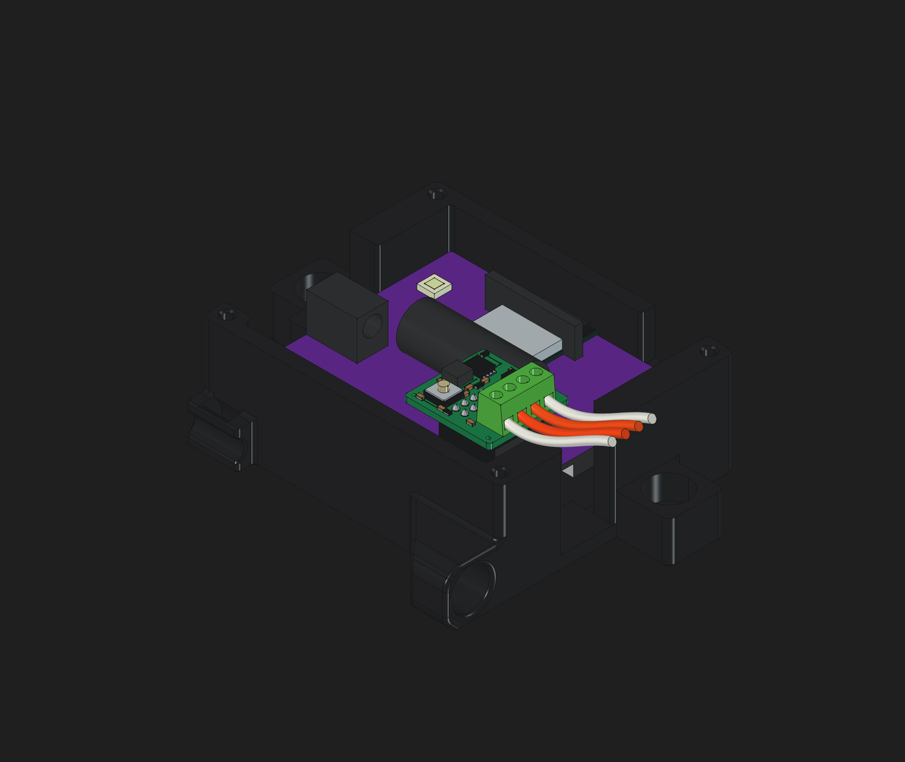
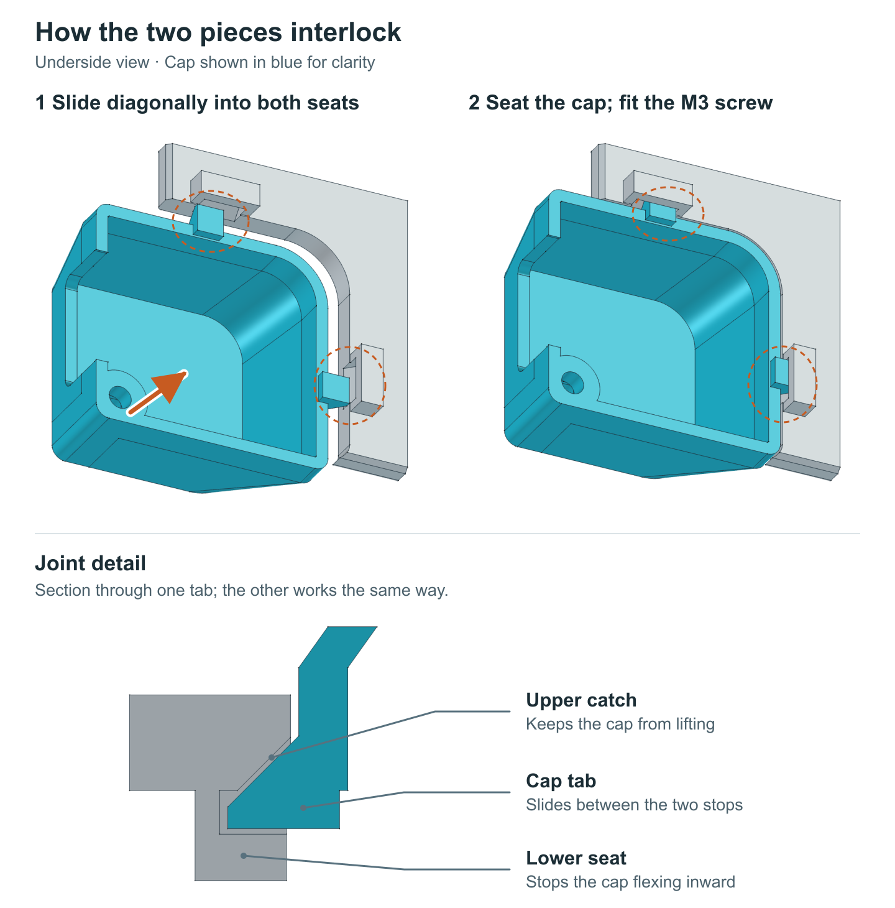

# OSSM RS-485 PCB Cover

A two-piece cover that makes room for the RS-485 breakout adapter while keeping the main cover flat to print. Marked ports, cyan buttons and a pink heart identify the controls. The clear light-pipe insert installs after printing.

[3MF](https://media.githubusercontent.com/media/researchanddesire/community-mods/632be5da6842f702ed88f2975f30b3ce9d390fee/mods/ossm/ossm-rs485-pcb-cover/print/OSSM-RS485-Complete.3mf) · [FreeCAD](https://media.githubusercontent.com/media/researchanddesire/community-mods/632be5da6842f702ed88f2975f30b3ce9d390fee/mods/ossm/ossm-rs485-pcb-cover/cad/OSSM-Cover-RS485.FCStd) · [STEP](https://media.githubusercontent.com/media/researchanddesire/community-mods/632be5da6842f702ed88f2975f30b3ce9d390fee/mods/ossm/ossm-rs485-pcb-cover/cad/OSSM-Cover-RS485.step) · [Tab-seat cutaway](img/inward-stop-section.png)

- The 3MF contains three plates: main cover, cap and clear insert, with colors assigned.
- Print the main cover front-down and the cap roof-down, with supports off.
- Slide both cap tabs diagonally into their seats, as shown below, then reuse the original corner M3 screw.

By [Lucy Chapar](https://github.com/lucy-chapar), based on the [OSSM PCB enclosure](https://github.com/researchanddesire/OSSM/tree/main/hardware/cad/stand). [CERN-OHL-S-2.0](../../../LICENSES/CERN-OHL-S-2.0.txt).
